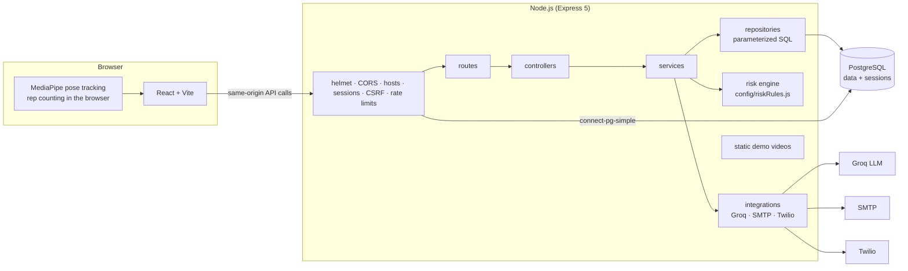

# ReviveCare API

The backend of ReviveCare, a post-surgery rehabilitation app: patients log in, chat with an AI assistant that knows their doctor's notes (English or Hindi), and track exercises with their camera; the doctor is alerted when a message looks serious.

Node.js 22, Express 5 and PostgreSQL, with raw SQL through `pg` (no ORM). It replaced a Django backend while keeping every URL, JSON response, cookie and rule the React frontend relies on; equivalence is checked by a parity suite that sends the same requests to both.

## Architecture



A request goes route → guards (session, CSRF, validation) → controller (HTTP only) → service (business rules, no SQL) → repository (SQL only). The chat's seriousness rules (clamp, fallback, alert when the score is above 0.75) live in one declarative config, `src/config/riskRules.js`, validated at startup.

## Setup from zero

### 1. PostgreSQL

macOS (Homebrew):

```sh
brew install postgresql@14
brew services start postgresql@14
createuser revivecare
createdb -O revivecare revivecare_dev
createdb -O revivecare revivecare_test
createdb -O revivecare revivecare_parity
```

`revivecare_test` is rebuilt by the test suite; `revivecare_parity` by the parity suite and the benchmark. The local role has no password; use one (in the connection URL) anywhere else.

### 2. Environment

```sh
cp .env.example .env
```

Required: `DATABASE_URL` (e.g. `postgres://revivecare@localhost:5432/revivecare_dev`), `SESSION_SECRET` and `CSRF_SECRET` (32+ random characters each, e.g. `openssl rand -hex 32`). For tests: `TEST_DATABASE_URL`; for parity: `PARITY_DATABASE_URL`. Chat needs `GROQ_API_KEY`; doctor alerts use `SMTP_SERVER`, `SMTP_PORT`, `EMAIL_SENDER`, `EMAIL_PASSWORD`, `DOCTOR_EMAIL` and optionally the `TWILIO_*` values. Every variable is described in `.env.example`; the server refuses to start and names the problem if one is missing or invalid.

### 3. Install, migrate, load data

```sh
npm install
npm run db:migrate
```

Then either copy the data from the old Django SQLite file (only into empty tables, and only from a copy):

```sh
cp ../legacy_django_backend/db.sqlite3 /tmp/revivecare.sqlite3
npm run db:etl -- /tmp/revivecare.sqlite3
```

or generate demo data (deterministic; needs `SEED_USER_PASSWORD`):

```sh
npm run db:seed
```

### 4. Run

```sh
npm run dev        # API on http://localhost:3000 (restarts on changes)
```

In `../ReViveCare_Frontend`: leave `VITE_API_BASE_URL` unset and run `npm run dev`; open http://localhost:5173. The Vite dev server forwards the API paths to port 3000 (`VITE_PROXY_TARGET` to change it), so the browser sees a single origin and the session cookie just works.

Check: `curl http://localhost:3000/api/health` → `{"status":"ok","db":"ok"}`.

### 5. Test

```sh
npm test               # unit + integration tests (rebuilds revivecare_test)
npm run test:coverage  # with coverage
npm run lint && npm run format:check
```

Golden tests compare the Node logic with outputs generated by the original Python code (`tests/fixtures/*_golden.json`; regenerate with `../parity-tools/golden.sh`). The frontend's exercise logic has its own golden test: `npm test` in `../ReViveCare_Frontend`.

### 6. Parity with the Django reference

This needs the original Django backend checked out locally at `../legacy_django_backend/` (with its `venv/`); it isn't part of this repository.

```sh
../parity-tools/make-reference-copy.sh   # once: throwaway Django copy + snapshot
npm run parity                           # resets both sides, runs every scenario
```

It starts the Django copy on port 8001 and a local stand-in for the LLM API, replays `tests/parity/scenarios/*.json` against both backends, and writes `tests/parity/report.md`. Accepted differences (behaviour changed on purpose) are listed per scenario with the reason.

## Folder guide

| Path                | What's in it                                                                                                                        |
| ------------------- | ----------------------------------------------------------------------------------------------------------------------------------- |
| `src/server.js`     | Process entry: config, database check, listen, graceful shutdown                                                                    |
| `src/app.js`        | `createApp()`: middleware order, routes, 404, error handler                                                                         |
| `src/config/`       | `env.js` (the only file that reads `process.env`, validated with zod), `ai.js` (model settings), `riskRules.js` (seriousness rules) |
| `src/routes/`       | Every route at its exact path, with its guards and body parser                                                                      |
| `src/controllers/`  | HTTP in and out; no SQL, no rules                                                                                                   |
| `src/services/`     | Business logic: login, dashboard, doctor upsert, chat turn, alerts, exercise sets, risk engine                                      |
| `src/repositories/` | All SQL                                                                                                                             |
| `src/integrations/` | Groq (prompt text and client), alert email, Twilio call                                                                             |
| `src/middleware/`   | Sessions, CSRF, CORS, allowed hosts, auth guard, rate limits, static files, 404, errors                                             |
| `src/utils/`        | Response helpers, password hashing, Python-compatible parsing (`json.loads`, `float()`, `str()`)                                    |
| `src/validators/`   | zod request schemas                                                                                                                 |
| `db/migrations/`    | Forward-only SQL migrations                                                                                                         |
| `scripts/`          | Migration runner, ETL, seed, benchmark, parity runner, opt-in live LLM check                                                        |
| `static/`           | The four exercise demo videos                                                                                                       |
| `tests/`            | `unit/`, `integration/`, golden `fixtures/`, `parity/` scenarios and report                                                         |
| `bench/`            | Benchmark results (`baseline.json`, `indexed.json`)                                                                                 |

## Scripts

| Command                                       | What it does                                                                            |
| --------------------------------------------- | --------------------------------------------------------------------------------------- |
| `npm run dev` / `npm start`                   | Run the API (with / without auto-restart)                                               |
| `npm test`, `test:watch`, `test:coverage`     | Tests                                                                                   |
| `npm run lint`, `format`, `format:check`      | ESLint and Prettier                                                                     |
| `npm run db:migrate`, `db:status`, `db:reset` | Apply migrations, show status, drop everything (dev/test/parity databases only)         |
| `npm run db:etl -- <sqlite copy>`             | Copy the Django data into empty tables                                                  |
| `npm run db:seed`                             | Generate demo data (dev/test/parity databases only)                                     |
| `npm run bench`                               | Benchmark the queries with and without the index migration (resets `revivecare_parity`) |
| `npm run parity`                              | Run the Django-vs-Node parity suite                                                     |
| `npm run groq:smoke`, `groq:capture`          | Opt-in calls to the real LLM API (cost money; refuse to run without `GROQ_LIVE=1`)      |

## API

| Method and path                 | Who     | What                                                                                                 |
| ------------------------------- | ------- | ---------------------------------------------------------------------------------------------------- |
| `GET /csrf/`                    | anyone  | Sets the `csrftoken` cookie                                                                          |
| `POST /login/`                  | anyone  | Email login (form body) → 302 to the dashboard, or to `/` if unknown                                 |
| `POST /patient/logout/`         | patient | Ends the session (CSRF token required)                                                               |
| `GET /patient/dashboard/`       | patient | `{"patient": {id, name, email, info}}`, 401 when logged out                                          |
| `POST /patient/chatbot/send/`   | patient | `{message, language}` → `{"success", "response", "seriousness_score"}`; alerts the doctor above 0.75 |
| `POST /doctor_info`             | anyone  | Add or update a patient: `{name, email, info}` → `{"success", "created"}`                            |
| `POST /exercise/sessions/`      | patient | Store a finished or abandoned exercise set (CSRF token required)                                     |
| `GET /static/Patients/videos/*` | anyone  | Exercise demo videos                                                                                 |
| `GET /api/health`               | anyone  | Liveness and database check                                                                          |

## Performance

All request-path queries are index lookups costing 4–15 µs of database time with 1,200 patients and 20,000 sessions; one targeted index cut session-expiry cleanup from 1.19 ms to 0.17 ms (−86%). Measured with `npm run bench`: PostgreSQL's own execution time from `EXPLAIN (ANALYZE, BUFFERS)`, 20 runs per query after 5 warm-ups, before and after the index migration, on seeded data (1,260 users, 62,428 exercise sessions, 84,704 chat messages, 20,000 sessions). Raw results: `bench/baseline.json`, `bench/indexed.json`.

## Operations

- **Logs:** JSON (pino) on stdout; level from `LOG_LEVEL`; readable output (pino-pretty) only in development (`LOG_PRETTY`). Logs carry patient ids, never names, emails, chat text or credentials. In development, every request also logs how many queries it ran (debug level).
- **Health:** `GET /api/health` returns 200 with the database reachable, 503 otherwise.
- **Graceful shutdown:** on SIGTERM/SIGINT the server stops accepting connections, lets in-flight requests finish (up to 10 s), closes the database pool and exits 0. Checked by hand: a request still uploading when SIGTERM arrived was answered, then the log showed `shutting down` → `shutdown complete`, exit code 0.

## Deployment notes (not deployed yet)

How the browser reaches the API decides the cookie settings. Both cookies are `SameSite=Lax`; the session cookie is `HttpOnly` and `Secure` in production; the CSRF cookie `csrftoken` must be readable by JavaScript, because the frontend copies it into the `X-CSRFToken` header.

### Recommended: one origin

Serve the built frontend and the API from the same host (e.g. `https://app.example.com`) behind a reverse proxy (nginx, Caddy or the platform's routing) that sends these paths to Node and everything else to the static build: `/csrf/`, `/login/`, `/patient/dashboard/`, `/patient/logout/`, `/patient/chatbot/send/`, `/doctor_info`, `/exercise/sessions/`, `/static/`, `/api/health`.

- Build the frontend with `VITE_API_BASE_URL` empty.
- Node: `NODE_ENV=production`, `ALLOWED_HOSTS=app.example.com`, `CSRF_TRUSTED_ORIGINS=https://app.example.com`.
- **Set `TRUST_PROXY`** (e.g. `1` for one proxy hop). TLS ends at the proxy; without it Express treats requests as plain HTTP and **silently doesn't send the `Secure` session cookie**, so login would redirect without logging anyone in. It also makes the rate limiters see the client's real address.
- Redirect HTTP to HTTPS in the proxy; Node sends HSTS in production but doesn't redirect.

### Frontend and API on different hosts

- **Sibling subdomains** (`app.example.com` + `api.example.com`): `SameSite=Lax` cookies still flow with `credentials: 'include'`, but the frontend can't read a `csrftoken` cookie set by `api.example.com`. That needs a CSRF cookie `Domain` option, which doesn't exist yet. Also set `VITE_API_BASE_URL`, `CORS_ALLOWED_ORIGINS`, `CSRF_TRUSTED_ORIGINS`, `ALLOWED_HOSTS` and `TRUST_PROXY`.
- **Different sites** (e.g. `*.vercel.app` + `*.onrender.com`): would need `SameSite=None; Secure` and another way to deliver the CSRF token; browsers increasingly block such cookies anyway. Not supported; use one origin.

### Other production settings

- Keep `SESSION_COOKIE_SECURE` at its production default (`true`).
- Secrets (`SESSION_SECRET`, `CSRF_SECRET`, `GROQ_API_KEY`, SMTP and Twilio values) come from the host's secret store, never from git.
- The login and chat rate limiters count in memory: correct for one Node process; use a shared store if you run several.
