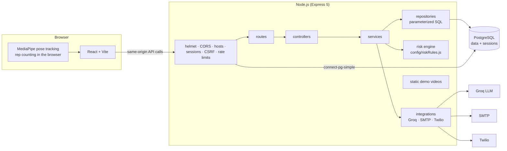

# ReviveCare API

The backend of ReviveCare, a post-surgery rehabilitation app: patients log in, chat with an AI assistant that knows their doctor's notes (English or Hindi), and track exercises with their camera; the doctor is alerted when a message looks serious.

Node.js 22, Express 5 and PostgreSQL, with raw SQL through `pg` (no ORM). It replaced a Django backend while keeping every URL, JSON response, cookie and rule the React frontend relies on; equivalence is checked by a parity suite that sends the same requests to both.

## Architecture



A request goes route → guards (session, CSRF, validation) → controller (HTTP only) → service (business rules, no SQL) → repository (SQL only). The chat's seriousness rules (clamp, fallback, alert when the score is above 0.75) live in one declarative config, `src/config/riskRules.js`, validated at startup.

## Setup from zero

### 1. PostgreSQL

macOS (Homebrew):

```sh
brew install postgresql@14
brew services start postgresql@14
createuser revivecare
createdb -O revivecare revivecare_dev
createdb -O revivecare revivecare_test
createdb -O revivecare revivecare_parity
```

`revivecare_test` is rebuilt by the test suite; `revivecare_parity` by the parity suite and the benchmark. The local role has no password; use one (in the connection URL) anywhere else.

### 2. Environment

```sh
cp .env.example .env
```

Required: `DATABASE_URL` (e.g. `postgres://revivecare@localhost:5432/revivecare_dev`), `SESSION_SECRET` and `CSRF_SECRET` (32+ random characters each, e.g. `openssl rand -hex 32`). For tests: `TEST_DATABASE_URL`; for parity: `PARITY_DATABASE_URL`. Chat needs `GROQ_API_KEY`; doctor alerts use `SMTP_SERVER`, `SMTP_PORT`, `EMAIL_SENDER`, `EMAIL_PASSWORD`, `DOCTOR_EMAIL` and optionally the `TWILIO_*` values. Every variable is described in `.env.example`; the server refuses to start and names the problem if one is missing or invalid.

### 3. Install, migrate, load data

```sh
npm install
npm run db:migrate
```

Then either copy the data from the old Django SQLite file (only into empty tables, and only from a copy):

```sh
cp ../legacy_django_backend/db.sqlite3 /tmp/revivecare.sqlite3
npm run db:etl -- /tmp/revivecare.sqlite3
```

or generate demo data (deterministic; needs `SEED_USER_PASSWORD`):

```sh
npm run db:seed
```

### 4. Run

```sh
npm run dev        # API on http://localhost:3000 (restarts on changes)
```

In `../ReViveCare_Frontend`: leave `VITE_API_BASE_URL` unset and run `npm run dev`; open http://localhost:5173. The Vite dev server forwards the API paths to port 3000 (`VITE_PROXY_TARGET` to change it), so the browser sees a single origin and the session cookie just works.

Check: `curl http://localhost:3000/api/health` → `{"status":"ok","db":"ok"}`.

### 5. Test

```sh
npm test               # unit + integration tests (rebuilds revivecare_test)
npm run test:coverage  # with coverage
npm run lint && npm run format:check
```

Golden tests compare the Node logic with outputs generated by the original Python code (`tests/fixtures/*_golden.json`; regenerate with `../parity-tools/golden.sh`). The frontend's exercise logic has its own golden test: `npm test` in `../ReViveCare_Frontend`.

### 6. Parity with the Django reference

This needs the original Django backend checked out locally at `../legacy_django_backend/` (with its `venv/`); it isn't part of this repository.

```sh
../parity-tools/make-reference-copy.sh   # once: throwaway Django copy + snapshot
npm run parity                           # resets both sides, runs every scenario
```

It starts the Django copy on port 8001 and a local stand-in for the LLM API, replays `tests/parity/scenarios/*.json` against both backends, and writes `tests/parity/report.md`. Accepted differences (behaviour changed on purpose) are listed per scenario with the reason.
