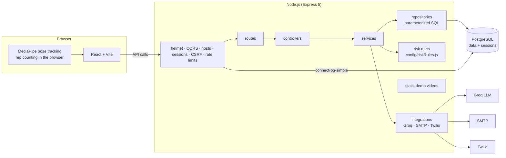

# ReViveCare — Backend


The REST API behind **ReViveCare**, a post-surgery rehabilitation assistant I built as a personal project. Patients chat with an AI assistant that knows their doctor's notes (in English or Hindi) and do camera-tracked exercises; the doctor is alerted automatically when a patient's message sounds serious.

> **About this project.** ReViveCare is a student project, built and maintained by me, [Tushar Singla](#author), a final-year B.Tech IT student. It isn't a commercial product, and it isn't meant for real patients or real medical data.

## Highlights

- **Rewritten from Django to Node.js without changing behaviour.** The first version of the backend was Django. I rewrote it in Node.js + Express + PostgreSQL and kept every URL, JSON response, cookie and rule the React app depends on. A parity suite sends the same 116 request scenarios to both backends and compares status codes, headers, cookies, bodies, sessions and stored rows.
- **Raw SQL, no ORM.** Every query is a parameterized `pg` query in a repository module; the schema is plain SQL migrations with a small checksum-verifying runner.
- **Rule-based seriousness checks for the AI chat.** The model's reply is parsed, its seriousness score clamped and checked against configurable thresholds (`src/config/riskRules.js`, validated at startup). Above 0.75 the doctor gets an email and, optionally, a phone call (Twilio).
- **Security basics done properly:** sessions stored in Postgres, CSRF protection, exact-origin CORS, security headers, rate limits on login and chat, input validation, and logs that never contain names, emails or chat text.
- **Tested:** 917 unit and integration tests (93% line coverage), plus golden tests that check the tricky parts (Python-style JSON parsing, number formatting, the prompt and alert text) against outputs generated by the original Python code.

## Try it: demo accounts

Log in on the patient login page with one of these accounts. They hold made-up data only:

| Name                    | Email (login)                   | Password   | Medical notes (made up)              |
| ----------------------- | ------------------------------- | ---------- | ------------------------------------ |
| Demo Patient (Knee)     | `demo.knee@revivecare.test`     | `demo1234` | knee ACL reconstruction, 10 days ago |
| Demo Patient (Hip)      | `demo.hip@revivecare.test`      | `demo1234` | hip replacement, 3 weeks ago         |
| Demo Patient (Shoulder) | `demo.shoulder@revivecare.test` | `demo1234` | rotator cuff repair, 6 weeks ago     |

Patient login is **email only** in this version: the password field has to be filled in, but its value isn't checked. The doctor pages need no login; if you add a patient there, please use made-up details. To create or reset these accounts on a database, run `npm run db:demo`.

## Tech stack

| Area                  | Choice                                                                                       |
| --------------------- | -------------------------------------------------------------------------------------------- |
| Runtime and framework | Node.js 22, Express 5, ES modules                                                            |
| Database              | PostgreSQL 14 with `pg` (no ORM), SQL migrations                                             |
| Sessions and security | `express-session` + `connect-pg-simple`, `csrf-csrf`, `helmet`, `cors`, `express-rate-limit` |
| Validation and config | `zod`                                                                                        |
| AI and alerts         | `groq-sdk` (Llama 3.3 70B), `nodemailer`, Twilio REST API                                    |
| Logging               | `pino`, `pino-http`                                                                          |
| Testing and tooling   | Vitest, Supertest, ESLint, Prettier                                                          |

## Architecture



Every request follows the same path: route → guards (session, CSRF, validation) → controller (HTTP only) → service (business rules, no SQL) → repository (SQL only).

## Getting started

**Requirements:** Node.js 22+, PostgreSQL 14+.

### 1. Database

macOS (Homebrew):

```sh
brew install postgresql@14
brew services start postgresql@14
createuser revivecare
createdb -O revivecare revivecare_dev
createdb -O revivecare revivecare_test
createdb -O revivecare revivecare_parity
```

`revivecare_test` is rebuilt by the test suite and `revivecare_parity` by the parity suite and the benchmark.

### 2. Environment

```sh
cp .env.example .env
```

Required: `DATABASE_URL` (e.g. `postgres://revivecare@localhost:5432/revivecare_dev`), `SESSION_SECRET` and `CSRF_SECRET` (32+ random characters each, e.g. `openssl rand -hex 32`). The chat needs `GROQ_API_KEY`; doctor alerts use the `SMTP_*`, `EMAIL_*`, `DOCTOR_EMAIL` and optional `TWILIO_*` values. Every variable is described in `.env.example`, and the server refuses to start, naming the problem, if one is missing or invalid.

### 3. Install, migrate, add data

```sh
npm install
npm run db:migrate
npm run db:demo     # the demo accounts above
npm run db:seed     # optional: 1,200 generated patients for local testing (needs SEED_USER_PASSWORD)
```

### 4. Run

```sh
npm run dev         # http://localhost:3000, restarts on changes
curl http://localhost:3000/api/health   # → {"status":"ok","db":"ok"}
```

Then start the frontend (`npm run dev` in `../ReViveCare_Frontend`) and open http://localhost:5173. Its dev server forwards API calls to port 3000.

## Testing

```sh
npm test                # unit + integration tests
npm run test:coverage   # with a coverage report
npm run lint && npm run format:check
```

- **Golden tests** (`tests/fixtures/*_golden.json`) compare the Node logic with outputs generated by the original Python code; `../parity-tools/golden.sh` regenerates them.
- **Parity tests** compare the running Node API with the original Django backend. They need that Django code checked out locally at `../legacy_django_backend/` (it isn't in this repository): run `../parity-tools/make-reference-copy.sh` once, then `npm run parity`.

## Project structure

| Path                | What's in it                                                                                              |
| ------------------- | --------------------------------------------------------------------------------------------------------- |
| `src/server.js`     | Entry point: config, database check, listen, graceful shutdown                                            |
| `src/app.js`        | `createApp()`: middleware order, routes, 404 and error handling                                           |
| `src/config/`       | `env.js` (environment variables, validated), `ai.js` (model settings), `riskRules.js` (seriousness rules) |
| `src/routes/`       | All routes with their guards and body parsers                                                             |
| `src/controllers/`  | HTTP in and out                                                                                           |
| `src/services/`     | Business logic: login, dashboard, adding patients, chat, alerts, exercise sets, risk checks               |
| `src/repositories/` | All SQL                                                                                                   |
| `src/integrations/` | Groq (prompt and client), alert email, Twilio call                                                        |
| `src/middleware/`   | Sessions, CSRF, CORS, allowed hosts, login guard, rate limits, static files, errors                       |
| `src/utils/`        | Response helpers, password hashing, Python-compatible parsing                                             |
| `src/validators/`   | Request schemas                                                                                           |
| `db/migrations/`    | SQL migrations                                                                                            |
| `scripts/`          | Migration runner, data import, seed, demo accounts, benchmark, parity runner                              |
| `static/`           | Exercise demo videos                                                                                      |
| `tests/`            | Unit, integration, golden and parity tests                                                                |
| `bench/`            | Benchmark results                                                                                         |

## Scripts

| Command                                       | What it does                                                                   |
| --------------------------------------------- | ------------------------------------------------------------------------------ |
| `npm run dev` / `npm start`                   | Run the API (with / without auto-restart)                                      |
| `npm test`, `test:watch`, `test:coverage`     | Tests                                                                          |
| `npm run lint`, `format`, `format:check`      | ESLint and Prettier                                                            |
| `npm run db:migrate`, `db:status`, `db:reset` | Apply migrations, show their status, reset (local databases only)              |
| `npm run db:demo`                             | Create or reset the demo accounts                                              |
| `npm run db:seed`                             | Generate test data (local databases only)                                      |
| `npm run db:etl -- <sqlite copy>`             | Import the data from the original Django database                              |
| `npm run bench`                               | Benchmark the main queries with and without the index migration                |
| `npm run parity`                              | Run the Django-vs-Node parity tests                                            |
| `npm run groq:smoke`, `groq:capture`          | Opt-in calls to the real LLM API (they cost money, so they need `GROQ_LIVE=1`) |

## API

| Method and path                 | Who     | What                                                                                   |
| ------------------------------- | ------- | -------------------------------------------------------------------------------------- |
| `GET /csrf/`                    | anyone  | Sets the `csrftoken` cookie                                                            |
| `POST /login/`                  | anyone  | Email login (form body) → redirect to the dashboard, or to `/` if the email is unknown |
| `POST /patient/logout/`         | patient | Ends the session                                                                       |
| `GET /patient/dashboard/`       | patient | `{"patient": {id, name, email, info}}`; 401 when logged out                            |
| `POST /patient/chatbot/send/`   | patient | `{message, language}` → `{"success", "response", "seriousness_score"}`                 |
| `POST /doctor_info`             | anyone  | Add or update a patient: `{name, email, info}` → `{"success", "created"}`              |
| `POST /exercise/sessions/`      | patient | Save a finished or abandoned exercise set                                              |
| `GET /static/Patients/videos/*` | anyone  | Exercise demo videos                                                                   |
| `GET /api/health`               | anyone  | Health check (database included)                                                       |

## Performance

Every query on the request path is an index lookup costing 4–15 µs of database time with 1,200 patients and 20,000 sessions. A targeted index cut the cleanup of expired sessions from 1.19 ms to 0.17 ms (−86%). Measured with `npm run bench`: PostgreSQL's own execution time (`EXPLAIN ANALYZE`), 20 runs per query after 5 warm-ups, before and after the index migration, on generated data. Raw results are in `bench/`.

## Operations

- **Logs:** JSON on stdout (readable output in development); the level comes from `LOG_LEVEL`.
- **Health check:** `GET /api/health` returns 200 when the database is reachable and 503 otherwise.
- **Graceful shutdown:** on SIGTERM the server stops taking new connections, lets in-flight requests finish (up to 10 s), closes the database pool and exits.

## Deployment

The app runs locally today. These are the notes I wrote for putting it online.

**Recommended setup: one domain.** Serve the built frontend and the API from the same domain behind a reverse proxy (nginx, Caddy or the hosting platform's routing) that sends the API paths (`/csrf/`, `/login/`, `/patient/…`, `/doctor_info`, `/exercise/sessions/`, `/static/`, `/api/health`) to Node and everything else to the frontend build. This keeps the session and CSRF cookies simple: both are `SameSite=Lax`, and the frontend reads the CSRF cookie from JavaScript, which only works on the same domain.

Production settings:

- `NODE_ENV=production`, `ALLOWED_HOSTS` and `CSRF_TRUSTED_ORIGINS` set to the public domain.
- `TRUST_PROXY` set (e.g. `1`). Without it, Express behind an HTTPS proxy thinks requests are plain HTTP and won't send the secure session cookie, so login would silently fail.
- HTTP redirected to HTTPS at the proxy (Node itself sends HSTS in production).
- Secrets (`SESSION_SECRET`, `CSRF_SECRET`, `GROQ_API_KEY`, SMTP and Twilio values) kept in the host's secret settings, never in git.
- Run `npm run db:migrate` and `npm run db:demo` once against the production database.

Hosting the frontend and API on two different domains would need changes to how the cookies and the CSRF token are delivered; I haven't made those.

## Known limitations

These are deliberate scope limits of a student project, carried over from the original version:

- Patient login checks only the email address; there are no real passwords yet.
- The doctor pages have no login, so anyone can add or edit a patient.
- The login and chat rate limits are kept in memory, which suits a single server process.

## Author

**Tushar Singla**, final-year B.Tech IT student at Maharaja Agrasen Institute of Technology, Delhi.

- GitHub: [@TR1CK5T4R](https://github.com/TR1CK5T4R)
- LinkedIn: [tushar-singla-b8aaa027b](https://www.linkedin.com/in/tushar-singla-b8aaa027b)

The frontend lives in [`../ReViveCare_Frontend`](../ReViveCare_Frontend).
